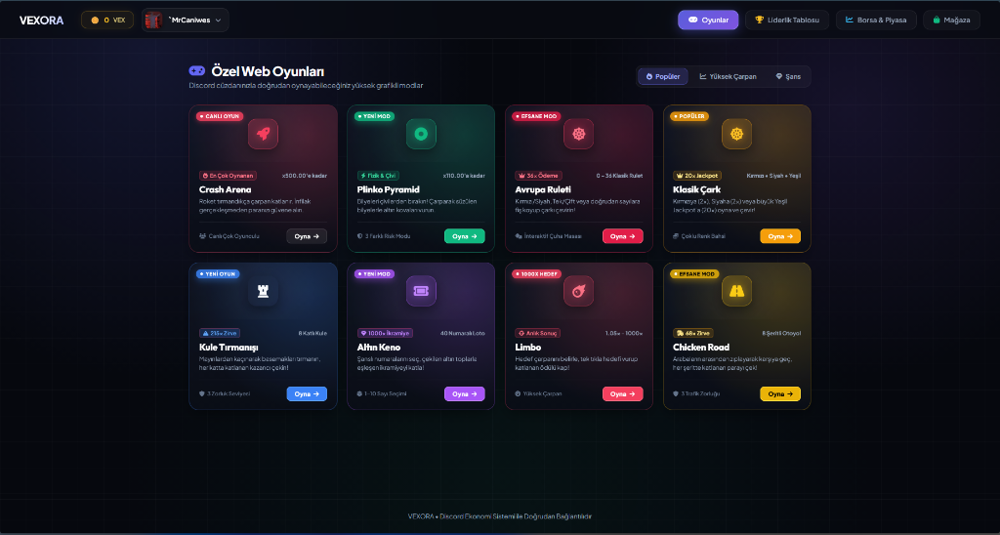
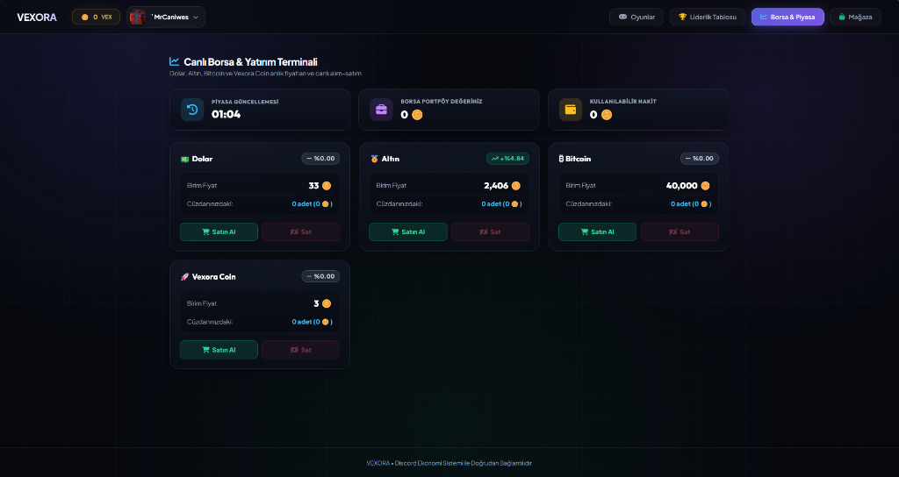
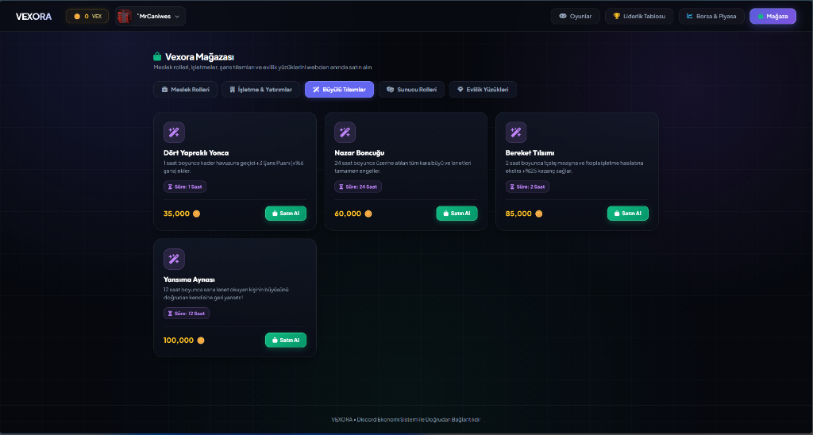
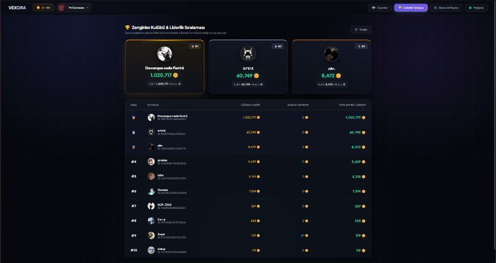

# 🪙 VEXORA - Discord Economy Bot & Interactive Web Casino v1

<div align="center">
  
  
  
  
  
</div>

<br/>

**Vexora** is a next-generation economy and casino ecosystem designed for Discord communities. Beyond traditional Discord slash commands, Vexora introduces a **cyber-aesthetic dark neon web platform featuring 8 physics-based casino games, an interactive live stock market & investment terminal, a multi-tier shop, and a real-time high-roller win feed.**

Players log in directly via Discord OAuth2 to access their synchronized live wallet, place bets in real-time, trade volatile market assets, and compete on the leaderboard.

---

## 📸 Web Platform UI Showcase

<div align="center">
  <h3>🎰 8 Custom Interactive Web Casino Games & Arenas</h3>
  

  <br/><br/>

  <h3>📈 Live Stock Market & Investment Terminal (USD, Gold, BTC, VEX)</h3>
  

  <br/><br/>

  <h3>🛍️ Vexora Market & Shop (Careers, Passive Income, Enchants & Rings)</h3>
  

  <br/><br/>

  <h3>🏆 Wealth Leaderboard & Real-Time Top Balances</h3>
  
</div>

---

## 🎮 1. Interactive Web Casino Games (8 Arenas)

Styled after modern platforms like Stake and Roobet, built with HTML5 Canvas physics and 100% mobile-responsive layouts:

1. **🚀 Crash Arena:** Watch the multiplier climb in real-time. Cash out before the rocket explodes—greed is your only enemy!
2. **🟢 Plinko Pyramid:** Drop balls from the apex of a 12-row peg pyramid and watch them bounce into multiplier buckets reaching up to **110x**.
3. **🎡 European Roulette (0 - 36):** Authentic European roulette featuring inside straight bets (36x payout), Red/Black, Odd/Even, and dozens with smooth deceleration physics.
4. **🎨 Classic Wheel:** Bet on Red (2x), Black (2x), or the rare Green jackpot segment (20x).
5. **🏰 Towers Climb:** Ascend an 8-story skyscraper. Pick the safe tiles on each floor while avoiding hidden mines. Cash out at any floor or reach the peak!
6. **🎱 Golden Keno:** Pick your lucky numbers from 1 to 40. Watch golden lotto balls draw and match for jackpots up to **1000x**.
7. **🎯 Limbo Rocket:** Set your preferred target multiplier (1.05x up to 1000x) and launch the rocket for an instant win evaluation.
8. **🐔 Chicken Road:** Dodge high-speed highway traffic across 8 lanes. Hop lane-by-lane and cash out before getting run over!

---

## 📈 2. Live Stock Market & Trading Terminal

* **Real-Time Assets:** USD, Gold, Bitcoin (BTC), and Vexora Coin (VEX).
* **Algorithmic Price Fluctuations:** Market prices dynamically shift on scheduled intervals. Buy the dips and take profits at all-time highs!
* **Portfolio Tracker:** Complete visibility of owned asset quantities, average cost basis, and net asset values.

---

## 🛍️ 3. Shop & Role Progression

* **Career Roles:** Farmer, Courier, Developer, Doctor, Pilot, and Enterprise Owner (multiplies `/work` income).
* **Passive Investments:** Vending Machines, Rental Apartments, Crypto Mining Rigs, Shopping Malls, and Holdings (upgradeable up to Level 5; collect revenue via `/collect`).
* **Mystical Talismans:** Abundance, Luck, and Curse Ward charms that boost drop rates and defend against malevolent spells.
* **Marriage Rings & Social Systems:** Silver, Gold, Emerald, and Diamond wedding bands with persistent partner shared revenue buffs.

---

## 📢 4. Real-Time Win Feed (Anti-Spam Throttling)

* Whenever a player hits a substantial win (**1,500 🪙+ or 2.5x+ multiplier**), an aesthetic celebratory embed is broadcast to the server's live activity channel.
* **Anti-Flood Queue Engine:** Low-tier spam is filtered out, and broadcasts are metered with a 4.5-second cooldown buffer to eliminate rate-limit spikes.

---

## ⚙️ Installation & Deployment

### 1. Clone Repository
```bash
git clone https://github.com/MrCaniwes/Vexora-Ekonomi.git
cd Vexora-Ekonomi
```

### 2. Install Dependencies
```bash
npm install
```

### 3. Configure Environment Variables
Copy `.env.example` to `.env` and fill in your credentials:
```ini
DISCORD_TOKEN=your_bot_token_here
CLIENT_ID=your_discord_client_id
CLIENT_SECRET=your_discord_oauth2_secret
GUILD_ID=your_discord_server_id

# Notification Channels
BORSA_KANAL_ID=stock_market_channel_id
CANLI_DURUM_KANAL_ID=live_feed_channel_id

# Web Platform Settings
PORT=3162
DOMAIN=https://your-domain-or-subdomain.com
```

### 4. Discord Developer Portal Redirect URL
Go to **Discord Developer Portal** -> Your Application -> **OAuth2** -> **Redirects**, and add:
```text
https://YOUR_DOMAIN/api/auth/callback
```

### 5. Launch the Application
```bash
node index.js
```

---

## 📜 Discord Slash Commands

| Command | Description |
| :--- | :--- |
| `/çalış` | Work your career job for active coin & XP rewards with cooldowns. |
| `/bakiye` | Check your liquid wallet balance, portfolio, and total net worth. |
| `/profil` | Inspect a modern card breakdown of career, investments, marriage, and wealth. |
| `/zenginler` | View the top 10 richest server whales on the wealth leaderboard. |
| `/mağaza` | Browse and purchase careers, passive investments, talismans, and rings. |
| `/yükselt` | Upgrade your owned business properties up to Tier 5 to maximize passive yield. |
| `/topla` | Collect passive income accumulated across your businesses. |
| `/transfer` | Send liquid currency to another server member. |
| `/borsa` | Interactive trading dashboard for quick asset purchases and sales. |
| `/canlidurum-ayarla` | Set or toggle the channel designated for high-roller live win broadcasts. |
| `/canlidurum-test` | Dispatch a sample test high-roller win card to verify configuration. |
| `/slot`, `/blackjack`, `/mines`, `/coinflip`, `/highlow`, `/kazikazan`, `/atyarisi` | In-Discord casino game commands. |

---

## 📄 License
This project is proprietary and custom-crafted. Unauthorized commercial redistribution or reselling is strictly prohibited.  
Copyright © 2026 **Vexora Development Team**. All rights reserved.
